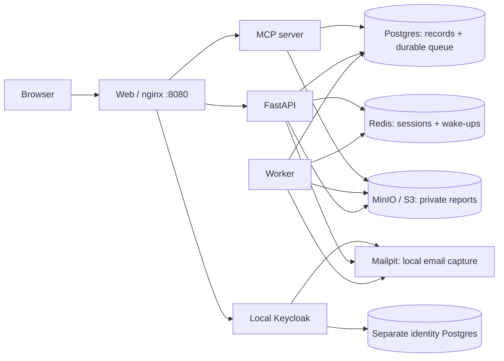

# Local → tunnel → cloud workbench

A standalone reference scaffold for two developers: run the entire stack locally,
share it through a tunnel, or deploy the same application Dockerfiles to Fly or
Render with Neon and external data services. This is separate from Eidolon and
its repository policies. No cloud resources are provisioned by `make up`.


## Choose the matching scaffold

| Starting point | Repository |
| --- | --- |
| New app using Supabase Auth, RLS, Storage, Realtime and Functions | [supabase-local-cloud-scaffold](https://github.com/theRealMarkCastillo/supabase-local-cloud-scaffold) |
| Existing exported app whose Supabase interfaces should be retained | [lovable-local-scaffold](https://github.com/theRealMarkCastillo/lovable-local-scaffold) |
| Custom API, OIDC sessions and independently selected data/worker/storage services | [local-cloud-demo](https://github.com/theRealMarkCastillo/local-cloud-demo) |

A worker can also be added to the Supabase starter; it does not automatically require
Redis. The main choice is Supabase's backend API contract versus your own API contract.
Repository links are private and require account access.

Review fixes, checks and scope: [review record](docs/REVIEW.md).

Public/internal URL configuration, tunnels and cloud callback registrations:
[URLs and callbacks](docs/URLS_AND_CALLBACKS.md).

## Try it

Requirements: Docker with Compose v2, `make`, and Python 3 for optional scripts.

```sh
cp .env.example .env
chmod 600 .env
make up
```

Open **http://localhost:8080**. Sign in as **demo / demo-password**. A second user, **demo-other**, has the same
local-only password for ownership-isolation checks.
First startup downloads images and initializes Keycloak; allow a few minutes.
Only the web entry point is bound to the host, on loopback. Postgres, Redis,
MinIO, Keycloak, and API ports are not published.

Submit some text. The separate worker writes a JSON analysis report into a
private MinIO bucket. Download it through the authenticated API. Reports and job
lists are scoped to the OIDC issuer + subject of the signed-in user.

```sh
make smoke                       # Real OIDC login, full job path, MCP PKCE login + tools
make email-config                # Reapply local Keycloak/Mailpit settings
make email-test                  # Send a synthetic message to local Mailpit
make email-smoke                 # Verify account email/reset flow with a synthetic user
make logs                        # Follow stack logs
make dev                         # API hot reload; frontend files mounted
make down                        # Stop containers; retain volumes
```

Worker edits require `docker compose up -d --build worker`; the worker does not
hot reload. To return from the dev override to packaged images, run `make down`
then `make up`. `docker compose down -v` is a **destructive reset of this demo's
local data**, including users and reports; it is deliberately not a Make target.
Changing database passwords or realm import JSON does not update existing volumes.

## What is in the stack?



| Service | Responsibility | Cloud equivalent |
| --- | --- | --- |
| web | Static UI and same-origin reverse proxy | Same Dockerfile on Fly or Render |
| api | OIDC login, sessions, authorization, job API, downloads | Same Dockerfile |
| worker | Separate process, same backend image | Same image, different command |
| mcp | MCP tools for the user's jobs/reports; Keycloak tokens for `PUBLIC_URL/mcp` | Same image, different command (not in cloud manifests) |
| postgres | App data and durable job records | Neon with TLS |
| redis | Server-side sessions and disposable job notifications | TLS Redis-compatible service |
| minio | Local S3-compatible private bucket | Private S3-compatible bucket |
| keycloak | Local OIDC identity provider | Hosted Keycloak or another OIDC provider |
| keycloak-db | Identity data, isolated from app DB | Managed by your chosen identity deployment |
| mailpit | Captured identity/application emails; inbox localhost:18026 | Real SMTP provider/sandbox; configure hosted IdP separately |
| init | Versioned app schema + local private bucket | Release migration; pre-created cloud bucket |

Email setup, account recovery and SMTP deployment settings: [EMAIL.md](docs/EMAIL.md).

Connect an MCP client, how its tokens are checked, and the optional CIMD setup:
[MCP.md](docs/MCP.md).

Redis is not the durable job queue: losing a notification does not lose a job.
Workers poll Postgres and claim rows with `FOR UPDATE SKIP LOCKED`. A short job
holds its transaction until the report is uploaded and completion is committed.
Crashes release the lock. Deterministic object keys make retries overwrite the
same result. Execution is **at least once**, not exactly once. For long-running
jobs, adopt leases/heartbeats, retry backoff, dead-letter handling, and idempotency
for external effects instead of holding a DB transaction open.

## OrbStack URLs and login origins

Login cookies and callbacks use one configured origin. If you open OrbStack's
`https://web.local-cloud-demo.orb.local` instead of localhost, configure it first:

```sh
make tunnel-set URL=https://web.local-cloud-demo.orb.local
```

This also works for HTTPS tunnel origins. Sign-in now starts on the configured
origin even when you open an alternate hostname; the page shows that address.
After an origin change, start a new sign-in rather than reusing an old login tab.
The credentials are still `demo` / `demo-password`. `make smoke` reads the configured
origin from `.env`; on macOS it uses the existing public OrbStack CA certificate
for local HTTPS verification. An explicit `DEMO_CA_FILE` is also supported. See the identity namespace
warning in `docs/SOCIAL_LOGIN.md` before changing an issuer with real user data.

## Share a local demo

Run either `ngrok http 8080` or your existing Funnel command for localhost:8080.
Use the resulting HTTPS **origin**, without a trailing path:

```sh
make tunnel-set URL=https://YOUR-DEMO-HOST
```

This updates `.env`, recreates this project's containers with the public origin,
and updates the local Keycloak client's exact redirect URI. Open the **public URL**
to sign in; localhost login is no longer the configured callback origin. To return:

```sh
make tunnel-set URL=http://localhost:8080
```

A stable tunnel hostname avoids repeated configuration changes. Keycloak issuer,
callback, and cookies must all agree on the origin. Existing app login sessions
are cleared when the origin changes. Tunnel traffic reaches only nginx; nginx
blocks Keycloak's admin endpoints. To administer local Keycloak, use
`docker compose exec keycloak /opt/keycloak/bin/kcadm.sh` or a deliberate local-only
admin mapping. Do not tunnel database ports or admin consoles.

**Before sharing:** change the demo user's password and use synthetic data. The
published example password is not access control for a public demo. Demo startup
uses Keycloak `start-dev` and a realm with `sslRequired=none`; these are local-only
choices, not a production identity deployment. A tunnel provides reachability,
not an authorization policy. No tunnel is created automatically by this project.

## Social login and extending the template

The application can stay local while Keycloak brokers real Google or Apple login.
Google and Apple are **not configured or tested yet**. Their callback registrations
and credentials are separate from the application's Keycloak client. Apple also
needs a reviewed compatible integration and an HTTPS domain/return URL.

See [social login setup and verification](docs/SOCIAL_LOGIN.md) for provider steps,
secrets, account linking and tunnel considerations. See the
[reusable stack pattern](docs/STACK_PATTERN.md) for optional modules, including
email, scheduling and observability, and how to copy the scaffold to another project.

## The portability contract

Application images contain application code. Addresses, credentials, and public
origins come from configuration. Compose service names never appear in Python or
browser code. The browser uses relative `/api` and `/auth` URLs and receives no
service credentials. Cloud builds don't require bind mounts or local files.

See [cloud deployment](docs/CLOUD.md), [identity and secrets](docs/SECURITY.md),
[validation record](docs/VALIDATION.md), and the exact configuration names in `.env.cloud.example`.

The provider files are optional starting points, not proof of a deployed cloud
system. They deliberately use paid cloud app services and do not promise idle
workers will wake automatically. Local Compose is the primary development path.

## Repository map

- `compose.yaml`: complete local stack, named volumes, readiness ordering.
- `compose.dev.yaml`: local development overrides only.
- `backend/`: API, worker, versioned schema runner, one shared Dockerfile.
- `web/`: browser UI, nginx configuration, web Dockerfile.
- `identity/`: local-only Keycloak realm import.
- `cloud/`: separate Render Blueprint and Fly app definitions.
- `scripts/`: localhost smoke test, public-origin helper, local Keycloak email and MCP configuration.

The MinIO image is a digest-pinned **Chainguard build of MinIO**, because the
upstream Docker Hub/Quay images were unavailable during setup. It runs only inside
the local Docker network. Review image provenance/licensing and update image and
Python dependency pins as part of maintaining any project derived from this one.
