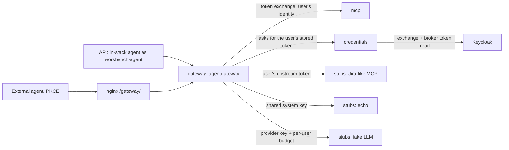

# Outbound agent gateway

Agents reach LLMs, MCP servers and other services through one gateway at
`PUBLIC_URL/gateway/`. Every call carries the real user, Keycloak decides which
agent may use which service, and the gateway logs the user (`jwt.sub`) and the
agent (`jwt.azp`) for every request. It is validated in local Docker Compose with
stand-ins. It is not deployed or runtime-tested in the cloud.

## Routes and how identity reaches each service

| Route | Role required | Credential the service receives |
| --- | --- | --- |
| `/gateway/mcp/workbench` | `workbench:read` (`submit_job` also needs `workbench:write`) | A Keycloak token for `PUBLIC_URL/mcp` with the user as `sub`, obtained by RFC 8693 token exchange (on-behalf-of). |
| `/gateway/mcp/jira` | `jira:use` | The user's own connected-account token, read from Keycloak by the `credentials` service. |
| `/gateway/echo/*` | `echo:use` | One shared system key held by the gateway. The user's token never reaches the service. |
| `/gateway/llm/v1/*` | `llm:use` | The provider key held by the gateway. Each user has a budget of 1000 tokens per hour, shared across their agents. |

The exchanged token names the user and the gateway (`azp=gateway`), not the agent,
and has no `act` claim: Keycloak's standard token exchange does not record a
delegation chain. The agent is enforced before the exchange and recorded in the
gateway's log.

Budgets live in the gateway's memory. `docker compose restart gateway` resets them;
`make smoke` does this itself.

## Governance: user ∩ agent

- The `gateway` client owns the roles `llm:use`, `workbench:read`,
  `workbench:write`, `jira:use` and `echo:use`.
- Users get roles through the groups `gateway-users` and `gateway-jira`.
- Each agent is its own Keycloak client with full scope off and scope mappings for
  only the roles it may use. A token carries only the roles the user holds **and**
  the agent is mapped to.
- The gateway accepts only tokens whose audience includes `PUBLIC_URL/gateway`.
  Only agent clients map that audience. Keycloak adds client-id audiences to any
  token that carries a client's roles, so the client id `gateway` alone must not be
  trusted as the audience.

| Client | Type | May use |
| --- | --- | --- |
| `agent-cli` | Public, PKCE, loopback redirects | `llm:use`, `workbench:read`, `jira:use`, `echo:use` |
| `agent-cli-writer` | Public, PKCE (used by the smoke test) | `workbench:read`, `workbench:write` |
| `workbench-agent` | Confidential; the API's sample agent | `llm:use`, `workbench:read`, `jira:use` |

To add an agent, add a client to `desired()` in `scripts/configure_gateway.py`
with its scope mappings, then run `python3 scripts/configure_gateway.py`. The
script is idempotent and runs on `make up`, `make dev` and `make tunnel-set`.

## Connected accounts

The Connections page (`/connections.html`) links a user's account at an outside
service once. Keycloak stores that service's tokens as a link-only identity
provider (`upstream-demo` locally) and refreshes them when read.

1. Connect redirects through Keycloak's account-linking action
   (`kc_action=idp_link:upstream-demo`) and returns to `/auth/link-callback`.
2. On a Jira-route request the gateway asks `credentials` for the user's token.
   `credentials` exchanges the agent's token for one that carries
   `broker/read-token`, reads the stored token from Keycloak and returns it as the
   upstream `Authorization` header. Only the `gateway-credentials` client is mapped
   to `read-token`, and `configure_gateway.py` turns off full scope on the built-in
   `admin-cli` and `security-admin-console` clients, so agents and browser sessions
   can never read stored tokens.
3. `credentials` caches a token per user and service in process memory for at most
   60 seconds, and never past 30 seconds before it expires.
4. Disconnect unlinks the account in Keycloak and evicts the cached token, so it
   takes effect at once.

Locally the outside service is the `upstream-demo` realm: sign in there as
`demo-upstream` with the demo password.

## Errors

| Condition | Response |
| --- | --- |
| Missing, invalid or wrong-audience token | 401 |
| Role missing for the route | 403, plain text `authorization failed` |
| Tool not allowed for this user and agent | Hidden from `tools/list`; calling it is an MCP error |
| Account not connected | 403 `{"error":"account_not_connected","connect_url":"PUBLIC_URL/connections.html?service=upstream-demo"}` |
| Token budget used up | 429 |
| `credentials` or Keycloak unavailable | 503 |

## Sample in-stack agent

"Run agent" on the home page calls `POST /api/agent/run`. The API exchanges the
user's server-side session token for a gateway token as `workbench-agent`, then
asks the LLM, lists the user's jobs and calls the Jira stand-in, all through the
gateway. The session cookie and the user's own tokens never leave the API.

## Using a real provider instead of the stand-in

Not tested against real accounts.

- **GitHub:** add Keycloak's built-in GitHub identity provider with "Store tokens"
  on and "Account linking only" on, then add its alias to `ALIASES` in
  `backend/app/credentials.py` and `backend/app/connections.py`, and a gateway
  route. GitHub OAuth apps do not issue refresh tokens by default.
- **Atlassian (Jira):** add a generic OAuth 2.0 / OpenID Connect provider with
  Atlassian's endpoints and the scopes the agent needs.
- Scopes are fixed per provider in Keycloak. Asking for more later means changing
  the provider's default scopes and linking again.
- Services that only take per-user API keys need a real secret store. Keycloak is
  not one.

## Proven in a spike, not built: per-user GCP access

1. Give the agent's token (or an exchanged one) the audience
   `https://iam.googleapis.com/projects/<number>/locations/global/workloadIdentityPools/<pool>/providers/<provider>`.
2. Exchange it at Google STS (`https://sts.googleapis.com/v1/token`,
   `subject_token_type=urn:ietf:params:oauth:token-type:jwt`).
3. Grant IAM roles to
   `principal://iam.googleapis.com/projects/<number>/locations/global/workloadIdentityPools/<pool>/subject/`.

GCP requires an `https` issuer, so this cannot run against the local `http`
stack. Prefer a public issuer so GCP fetches the signing keys itself; uploaded
keys must be uploaded again whenever Keycloak rotates them. Mapping
`attribute.agent=assertion.azp` would allow per-agent IAM conditions (untested).

## Limits

- Issued gateway tokens stay valid for up to five minutes after logout.
- Stand-in services (`stubs`, the `upstream-demo` realm) are local only.
- No per-agent budgets, no persistent budgets, no delegation (`act`) claims.
