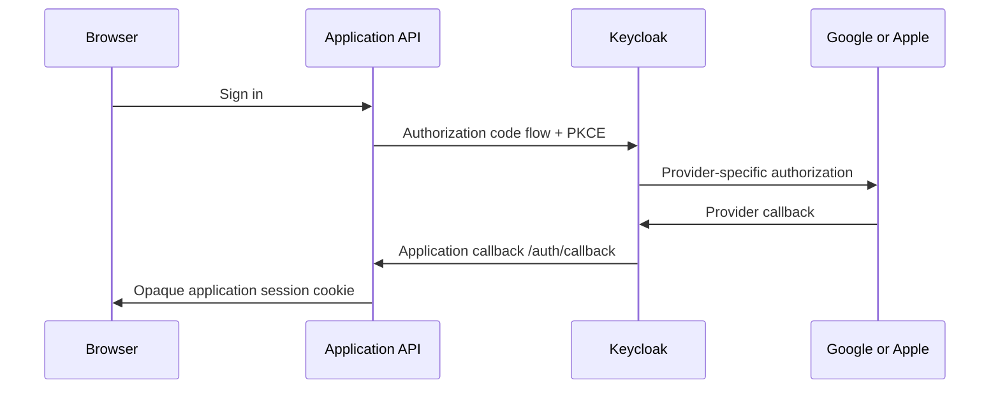

# External login with a local application stack

## Status and design

Local Keycloak username/password login is implemented and tested. Google and Apple
login are **integration plans**, not enabled or tested features in this repository.
There are no provider registrations, social-login secrets, or Apple extensions
bundled in the realm import. No external account or cloud setup runs automatically.

Keep the application an OIDC client of Keycloak. Configure social providers behind
Keycloak instead of adding Google/Apple token handling independently to every app:



Only the Google/Apple step needs their external service. Web, API, application
Postgres, worker, Redis, MinIO, Keycloak and identity Postgres can stay local.
For ordinary offline development, use the imported local users. Real provider
checks need internet access and registered provider credentials.

## Two callbacks, with different owners

| Connection | Callback registration | Credential owner |
| --- | --- | --- |
| Application → Keycloak | `PUBLIC_URL/auth/callback`, on the workbench Keycloak client | API holds the workbench OIDC client secret |
| Keycloak → Google | Broker callback shown by Keycloak's Google provider configuration | Keycloak holds Google's client ID/secret |
| Keycloak → Apple | Callback required by the selected Apple integration | Keycloak/integration holds Apple's identifiers and signing key |

Do **not** register the application's `/auth/callback` as Google's or Apple's
callback when Keycloak is the broker. For alias `google`, the usual local broker
callback is `http://localhost:8080/identity/realms/workbench/broker/google/endpoint`.
Always copy the exact callback displayed by your running provider configuration.
Changing the alias or realm changes that address.

The API continues to use the Keycloak realm as `OIDC_ISSUER_URL`, not Google's or
Apple's issuer. Keycloak emits the identity the application trusts. The same pattern
works when Keycloak is hosted separately and the application remains local.

## Google setup

1. Create a dedicated development Google OAuth **web application** client and
   configure its consent/audience settings. Add the two developers as test users
   when the project is in testing mode and requires a test-user list.
2. Add Google's built-in identity provider to the local `workbench` realm, with a
   deliberate alias such as `google`. Supply the Google client ID and secret.
3. Register the exact Keycloak broker redirect URI in Google. Google supports
   localhost web callbacks for development; a stable HTTPS tunnel is another option.
4. Request only needed identity scopes (normally `openid`, `profile`, `email`).
   Access to Google Drive/Gmail/etc. is a separate consent and token-lifecycle feature.
5. Review Keycloak's first-broker-login/account-linking flow and who may sign in.
   A provider button does not establish an invitation or organization policy.
6. Start a fresh browser session, choose Google on Keycloak's login page, and
   complete the verification cases below.

Provider credentials belong in Keycloak's configuration, not in the application
frontend or worker. Configure the local realm through Keycloak's admin CLI inside
the container. The default nginx entry point blocks admin UI/API routes. If you
choose a browser admin console, add a deliberate loopback-only admin setup; never
publish it through the demo tunnel.

## Apple setup

Treat Apple as a separate integration task. It is not configured as a built-in
social provider in this scaffold. Choose and review an Apple identity-provider
extension compatible with the pinned Keycloak version, or use a hosted broker
that explicitly supports Sign in with Apple. A community extension is an additional
software dependency, not an assurance of support or security.

1. Configure the Apple developer account: a Sign in with Apple-enabled primary
   App ID, web Services ID, associated domains/return URLs, and private signing key.
   Confirm current account/program requirements in Apple's documentation.
2. Use an HTTPS return URL with a domain name. Apple does not accept `localhost`
   or an IP address. A stable registered tunnel hostname can point to this local
   stack; using local containers does not remove Apple's registration requirements.
3. Build a dedicated Keycloak image with the reviewed extension, if needed. Pin its
   version, review its source/license and security updates, and document upgrades.
   Do not download an unpinned extension at container startup.
4. Supply the Services ID, Team ID, Key ID, and private key in the format the
   integration requires. Apple's client secret is a signed JWT with a validity
   period; plan its generation/renewal rather than treating it as an eternal password.
5. Verify the integration handles Apple's `form_post` callback, issuer/audience
   validation, first-login profile data, and private relay addresses. Broker callback
   cookies and application session cookies have different requirements; do not
   globally weaken the application's SameSite or CSRF policy to make a callback pass.
6. Test both first and returning logins. Store only profile information the product
   needs; handle absent optional names/emails without breaking identity ownership.

The current application callback accepts the Keycloak authorization-code redirect.
Direct Apple integration into that callback is **not implemented** and would require
additional protocol, key-management, and callback handling work.

## Tunnel workflow

Start ngrok or Funnel for localhost:8080, then run:

```sh
make tunnel-set URL=https://YOUR-STABLE-DEMO-HOST
```

The helper updates the local application origin and its Keycloak client callback.
It does **not** update registrations at Google/Apple, install providers, or rotate
provider secrets. Register the provider's broker return URL separately. For a new
hostname, update all affected registrations. Open the demo through its configured
public origin, not localhost, during that integration check.

The demo realm is still development-only. Change **both** published local user
passwords before exposing it and use synthetic data. Tunnel registration and social
login do not make Keycloak `start-dev` a production identity deployment.

## Secrets and identity continuity

- Keep Google/Apple secrets at the broker. The API needs only its Keycloak client
  credentials. The worker and web need no social-provider secrets.
- Compose does not inject every `.env` key automatically: adding `GOOGLE_SECRET`
  there alone does nothing. A future setup script or explicit environment/secret-file
  mapping must deliver it to the broker. No such social provisioning is implemented.
- Prefer secret-file mounts for signing keys and scripts that read secrets without
  printing them. For cloud use, follow the broker's secret store or deployment
  platform's secret facility. Never put private keys in realm JSON or Docker images.
- Keycloak persists provider configuration in its identity database. Realm exports,
  database dumps and backups may contain secrets; restrict and protect them.
- Use separate client registrations, keys and users for development and production.
  Document who owns each registration and when keys/client-secret JWTs expire.

Application ownership is keyed by **Keycloak issuer + subject**, not email. Do not
silently merge Google/Apple/local accounts just because email strings match. Require
an authenticated linking or recovery flow, and test that existing data stays attached
to the intended Keycloak user. Apple's relay email must not become the identity key.

Changing the Keycloak issuer (including switching this local realm's public hostname)
changes the application's computed owner identifier. Existing rows are retained but
may no longer appear under the new issuer; restoring the original issuer restores
that identity namespace. Prefer stable demo hostnames and plan identity/data mapping
before moving a real deployment between issuers. Switching providers while keeping
the same Keycloak user and issuer should preserve the application owner identity.

## Verification matrix

| Check | Local users | Google | Apple |
| --- | --- | --- | --- |
| App login, job ownership, logout | Existing `make smoke` coverage | Pending real-provider check | Pending real-provider check |
| First vs. returning sign-in | Basic local login covered | Pending | Pending; verify optional profile fields |
| Denied consent/cancelled login | Not covered | Pending | Pending |
| Incorrect callback/state/nonce/token | Normal flow validated; negative protocol cases not comprehensively tested | Pending | Pending |
| Existing-account linking, duplicate emails | Not implemented/tested | Pending | Pending; include relay email |
| Key rotation/expiry and revocation | Not exercised | Pending | Pending |
| App logout vs. upstream SSO logout | App session invalidation covered | Pending upstream behavior | Pending upstream behavior |
| HTTPS tunnel and cloud callback path | Alternate localhost origin tested; real HTTPS tunnel pending | Pending | Pending |

App logout clears the application's session only. Keycloak and social-provider SSO
sessions may remain. Full SSO logout, invitation policy, MFA/recovery policies and
account deletion are product requirements to implement explicitly when needed.

## Primary references

- [Keycloak identity brokering](https://www.keycloak.org/docs/latest/server_admin/#_identity_broker)
- [Google web-server OAuth](https://developers.google.com/identity/protocols/oauth2/web-server)
- [Apple environment configuration](https://developer.apple.com/documentation/signinwithapple/configuring-your-environment-for-sign-in-with-apple)
- [Apple authorization flow](https://developer.apple.com/documentation/signinwithapple/incorporating-sign-in-with-apple-into-other-platforms)
- [Apple token and return-URL requirements](https://developer.apple.com/documentation/SigninwithAppleRESTAPI/Generate-and-validate-tokens)
- [Example community Apple/Keycloak extension, not bundled or endorsed](https://github.com/BenjaminFavre/keycloak-apple-social-identity-provider)
